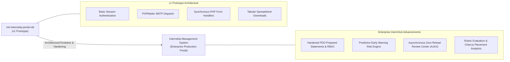

# MIT Internship Portal (v1 Legacy Prototype)

<p align="center">
  <strong>Foundational Academic Internship System Prototype — Historical Lineage & Evolution Reference</strong><br>
  <em>Preserved v1 architectural prototype for MIT-ADT University, documenting the evolution toward the modern enterprise InternHub platform.</em>
</p>

<p align="center">
  
  
  
  
</p>

---

> [!IMPORTANT]
> **Archival Lineage Notice:**  
> This repository preserves the initial **v1 prototype** of the MIT-ADT University Internship Portal. It is maintained for architectural lineage, historical tracking, and academic portfolio completeness.  
> 
> 👉 **For the active, enterprise-grade production platform** featuring 10 verified high-resolution interfaces, asynchronous AJAX review desks, predictive RiskAnalyzer scoring, and Chart.js domain analytics, visit **[Internship-Management-System](https://github.com/Swaraj0160/Internship-Management-System)**.

---

## Overview

The **MIT Internship Portal v1** was engineered as an early digital solution to replace paper-based weekly internship logs and fragmented email threads across the School of Computing at **MIT-ADT University, Pune**. 

The system established the foundational three-tier academic workflow:
- **Student Module (`/student`):** Application registration, periodic progress logs, and final document uploads.
- **Faculty Module (`/faculty`):** Mentor verification queues, revision requests, and semester mark allocations.
- **Coordinator Module (`/admin`):** Faculty and student provisioning, division registers, and spreadsheet exports.
- **Automated Mail Engine (`PHPMailer/`):** Triggered SMTP notifications informing students when submissions were vetted.

---

## The Academic Evolution: From v1 Prototype to Enterprise InternHub

### The v1 Prototype Challenge
- **Synchronous Page Reloads:** Early PHP form posts required page refreshes on every status change, causing guide fatigue during large batch reviews.
- **Manual Risk Identification:** Coordinators had to manually scan hundreds of rows in spreadsheets to find students lagging on submissions.
- **Single File Attachments:** Basic upload scripts lacked chunked transfer resilience or synthetic seed protection.

### The Modern v2 Solution (InternHub)
- **Zero-Reload AJAX Verification:** Instant `Accept`, `Reject`, and `Undo` status changes with real-time DOM synchronization.
- **Algorithmic Risk Engine (`lib/RiskAnalyzer.php`):** Predictive velocity analysis categorizing candidates into `Normal`, `Attention Needed`, and `Critical Risk`.
- **Chart.js Industry Placement Intelligence:** Real-time visual domain breakdowns across AI, Cloud, Cybersecurity, and Full-Stack roles.

---

## Architectural Evolution & Lineage Flow



---

## Technology Stack

Verified directly from source code and package configurations:

| Component | Technology | Description |
|---|---|---|
| **Backend Runtime** | PHP 7.4 / 8.x | Modular server-side scripts for student and faculty operations |
| **Relational Database** | MySQL 5.7+ / 8.0+ | Initial normalized relational schema for internship cohorts |
| **Email Subsystem** | PHPMailer 6.x | SMTP email integration for automated status notifications |
| **Frontend Layout** | HTML5, CSS3, Bootstrap 4 | Responsive grid layout with classic academic theming |

---

## Repository & Directory Structure

```text
mit-internship-portal-old/
├── admin/                     # Department administrator controllers & reports
│   ├── add_faculty.php        # Faculty onboarding
│   ├── add_student.php        # Student enrollment
│   ├── all_internships.php    # Department-wide internship roster
│   ├── download_excel.php     # Tabular export utility
│   ├── manage_faculty.php     # Mentor directory management
│   └── manage_students.php    # Student records management
├── faculty/                   # Faculty guide evaluation suite
│   ├── approve.php            # Submission approval handler
│   ├── dashboard.php          # Mentor overview
│   ├── evaluate_student.php   # Marking and grading interface
│   ├── reject.php             # Revision request handler
│   └── view_updates.php       # Weekly log inspector
├── student/                   # Student portal interface
│   ├── apply_internship.php   # Internship registration form
│   ├── dashboard.php          # Student progress summary
│   ├── my_updates.php         # Chronological update timeline
│   └── upload_report.php      # Document attachment handler
├── PHPMailer/                 # Bundled PHPMailer email distribution library
├── assets/                    # Static styling and university branding
├── login.php                  # Central role-based login gateway
├── logout.php                 # Session destruction
├── mail_function.php          # SMTP notification wrappers
└── README.md                  # Comprehensive architectural lineage documentation
```

---

## Author & Acknowledgements

- **Developer:** **Swaraj Ingale** ([@Swaraj0160](https://github.com/Swaraj0160))
- **Institution:** Department of Computer Science & Engineering, MIT-ADT University, Pune
- **Successor:** See the production-ready [InternHub Repository](https://github.com/Swaraj0160/Internship-Management-System)
