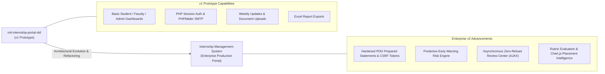

# MIT Internship Portal (v1 Legacy Prototype)

[](https://www.php.net/)
[](https://www.mysql.com/)
[](https://github.com/PHPMailer/PHPMailer)
[](#lineage--evolution)

> **Archival Notice:** This repository houses the initial **v1 prototype** of the MIT-ADT University Internship Portal. It is preserved for academic lineage and engineering history.  
> **Active Production Showcase:** For the modern, hardened, enterprise-grade edition featuring PDO prepared statements, rubric grading, Early Warning Risk Analytics, and asynchronous review centers, visit **[Internship-Management-System](https://github.com/Swaraj0160/Internship-Management-System)**.

---

## Lineage & Architectural Evolution



---

## Overview

The **MIT Internship Portal v1** was engineered as an initial digital solution to replace paper-based internship tracking and email coordination across the School of Computing at MIT-ADT University. 

It implemented foundational role-based access control for students, faculty guides, and departmental coordinators:
- **Student Module (`/student`):** Internship application logging, periodic progress updates, report uploads, and evaluation tracking.
- **Faculty Module (`/faculty`):** Application approval workflows, deadline management, feedback notes, and evaluation scoring.
- **Admin Module (`/admin`):** Faculty and student provisioning, departmental reports, and spreadsheet exports.
- **Mail Notification Engine (`PHPMailer/`):** Automated SMTP email alerts notifying students and mentors of status updates.

---

## Directory Topology

```text
mit-internship-portal-old/
├── admin/                     # Department administrator controllers & reports
│   ├── add_faculty.php        # Faculty onboarding
│   ├── add_student.php        # Student enrollment
│   ├── all_internships.php    # Department-wide internship roster
│   ├── download_excel.php     # Tabular export utility
│   ├── manage_faculty.php     # Mentor directory management
│   └── manage_students.php    # Student records management
├── faculty/                   # Faculty guide evaluation suite
│   ├── approve.php            # Submission approval handler
│   ├── dashboard.php          # Mentor overview
│   ├── evaluate_student.php   # Marking and grading interface
│   ├── reject.php             # Revision request handler
│   └── view_updates.php       # Weekly log inspector
├── student/                   # Student portal interface
│   ├── apply_internship.php   # Internship registration form
│   ├── dashboard.php          # Student progress summary
│   ├── my_updates.php         # Chronological update timeline
│   └── upload_report.php      # Document attachment handler
├── PHPMailer/                 # Bundled PHPMailer email distribution library
├── assets/                    # Static styling and university branding
├── login.php                  # Central role-based login gateway
├── logout.php                 # Session destruction
└── mail_function.php          # SMTP notification wrappers
```

---

## Technology Stack

- **Backend:** PHP 7.4 / 8.x
- **Database:** MySQL
- **Email Dispatch:** PHPMailer
- **Frontend:** HTML5, CSS3, JavaScript, Bootstrap

---

## Historical Setup (Reference)

### Prerequisites
- PHP 7.4+ or 8.x with `pdo_mysql` and `mysqli` extensions
- MySQL 5.7+ / 8.0+
- Web server (Apache via XAMPP/WAMP or built-in PHP development server)

### Local Setup
1. Clone the repository:
   ```bash
   git clone https://github.com/Swaraj0160/mit-internship-portal-old.git
   cd mit-internship-portal-old
   ```
2. Configure database credentials in your local PHP configuration or environment.
3. Serve via your local web server:
   ```bash
   php -S localhost:8000
   ```

---

## Authors & Attribution

- **Developer:** **Swaraj Ingale** ([@Swaraj0160](https://github.com/Swaraj0160))
- **Institution:** MIT-ADT University, Pune
- **Superseded By:** **[Internship-Management-System](https://github.com/Swaraj0160/Internship-Management-System)**
